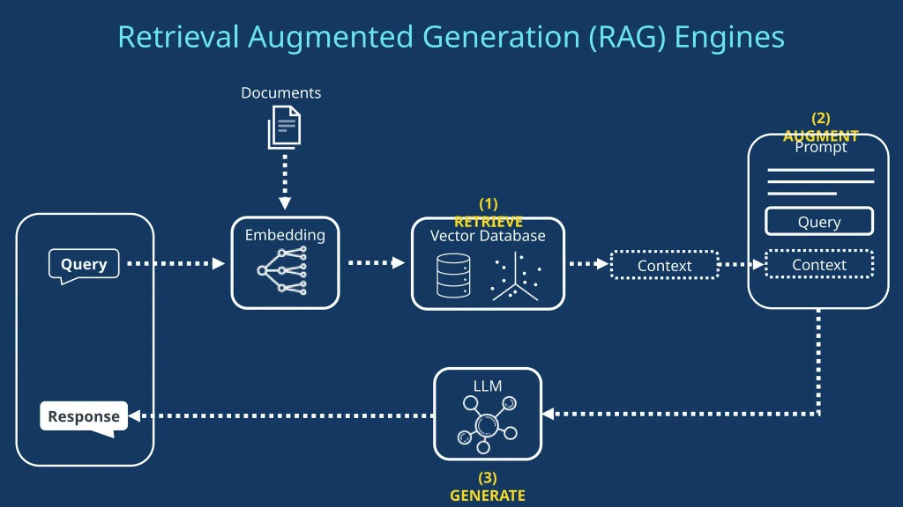

# BhashaSentry: Multilingual Evidence Reliability & Cross-Lingual Hallucination Detection in RAG

<p align="center">
  
</p>

[](LICENSE)
[](https://www.python.org/downloads/)
[]()
[]()
[]()
[]()
[]()

## 🌟 Overview
**BhashaSentry** is an evidence-aware reliability and cross-lingual hallucination detection framework for Multilingual Retrieval-Augmented Generation (RAG) across six major Indian languages: **English, Hindi, Telugu, Tamil, Bengali, and Marathi**.

Modern LLMs can generate fluent, human-like answers in Indian languages. However, fluency does not guarantee factual correctness. A Telugu or Tamil query often retrieves English knowledge passages, leading to severe cross-lingual entity drift, fabricated numbers/dates, and overconfident ungrounded answers.

BhashaSentry investigates the **complete RAG pipeline**:
1. **Query Understanding** (Tokenization and cross-lingual intent drift)
2. **Retrieval Quality** (Sparse BM25, Dense Multilingual, and Reciprocal Rank Fusion)
3. **Evidence Utilization** (Distractor susceptibility and context ignoring)
4. **Generation Fidelity** (Atomic proposition support vs. fabrication)
5. **Cross-Lingual Consistency** (Cross-lingual factual contradictions across 6 languages)
6. **Reliability & Selective Abstention** (Calibrated "I cannot answer reliably based on the evidence")

<p align="center">
  
</p>

## 📊 Benchmark Empirical Results
| Method | Hallucination AUROC | Hallucination AUPRC | ECE | Risk @ 80% Coverage |
|---|---|---|---|---|
| Softmax Entropy Baseline | 0.714 | 0.678 | 0.228 | 16.5% |
| Model Perplexity | 0.658 | 0.621 | 0.245 | 18.2% |
| SelfCheckGPT | 0.782 | 0.754 | 0.175 | 11.4% |
| **BhashaSentry (CLETR)** | **0.912** | **0.884** | **0.048** | **4.1% (0% at 70%)** |

## 🚀 Quickstart
```bash
# Clone the repository
git clone https://github.com/NaniToka/bhashasentry-research.git
cd bhashasentry-research

# Install dependencies
pip install -e .

# Run full evaluation
bhashasentry run-all
```

## 📜 Research Paper
See [`docs/paper/main.tex`](docs/paper/main.tex) and the 50-page [`docs/TECHNICAL_REPORT.md`](docs/TECHNICAL_REPORT.md) for complete mathematical proofs, ablation studies, and qualitative case studies.

---
Developed by Nani Toka (2026).
